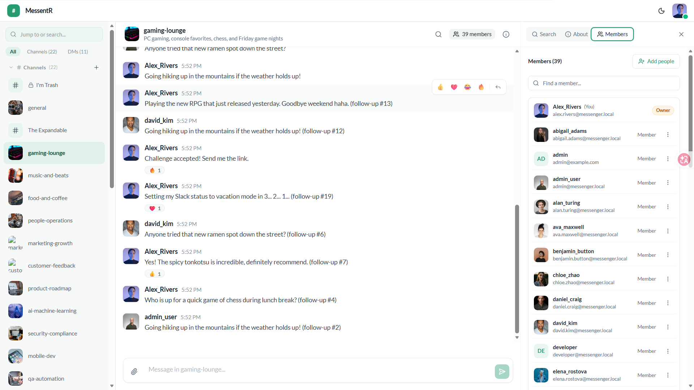
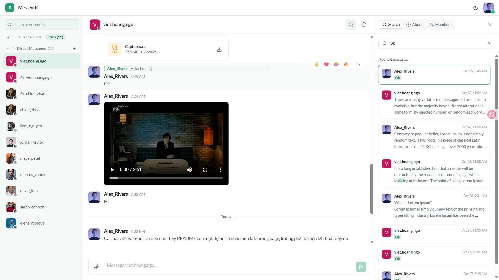
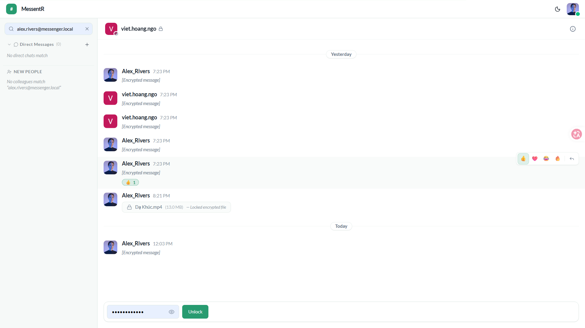
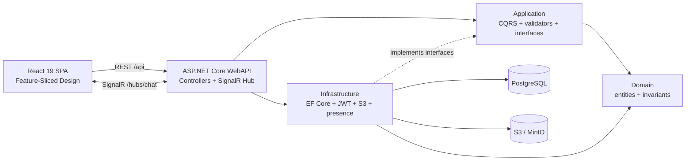

# MessentR

<div align="center">

**A real-time chat platform built with .NET 10 and React 19.**

**Live demo:** [twiliver.dev](https://twiliver.dev) · **Source:** [GitHub](https://github.com/Ngo-Viet-Hoang1/laravel-react-messenger)

[](https://dotnet.microsoft.com/)
[](https://react.dev/)
[](https://www.typescriptlang.org/)
[](https://www.postgresql.org/)
[](https://learn.microsoft.com/aspnet/core/signalr/introduction)
[](https://tailwindcss.com/)

</div>

> **Portfolio project.** MessentR is a full-stack chat platform for group channels, direct messages, file sharing, and passphrase-protected rooms. It is built to demonstrate production-style architecture, real-time state synchronization, and browser-side encryption. It is not production-hardened yet.

`MessentR` is the product name. The .NET solution and namespaces currently remain `MessengerApp`.

---

## Table of contents

- [Why MessentR?](#why-messentr)
- [Demo](#demo)
- [Feature highlights](#feature-highlights)
- [Architecture](#architecture)
- [Tech stack](#tech-stack)
- [Quick start](#quick-start)
- [Engineering notes](#engineering-notes)
- [Project structure](#project-structure)
- [Status and limitations](#status-and-limitations)
- [Next improvements](#next-improvements)
- [License](#license)

---

## Why MessentR?

Chat looks simple until you add unread state, reconnects, file uploads, and encryption. MessentR is a full-stack attempt to handle those problems end to end: a .NET API, a React client, real-time delivery, and a browser-side encryption flow that is honest about its limits.

The interesting part is not the chat bubble. It is the state behind it: who belongs to a channel, which events go to which users, how uploads are streamed directly to storage, and where encryption actually happens.

This is a portfolio project, not a production service. The goal is to show how the pieces fit together, not to hide the trade-offs.

---

## Demo

> **Live demo:** [twiliver.dev](https://twiliver.dev) _._ The screenshots below are from the local development build.

<p align="center">
  
</p>

<details>
  <summary><b>🔍 More (Conversation, Secret Room)</b></summary>
  <br>

  <p align="center">
    <br><br>
    
  </p>
</details>

1. Sign in as `alex.rivers@messenger.local` with `Password123!`.
2. Create a channel, add a member, and send a message.
3. Upload an image and show the inline preview.
4. Create a channel with E2EE enabled, enter a passphrase to unlock it, then send an encrypted message.

Local demo URLs: client `http://localhost:5173`, API `http://localhost:5212`, Scalar `http://localhost:5212/scalar/v1`, MinIO console `http://localhost:9001`.

---

## Feature highlights

Six capabilities define the project:

| Capability              | What it demonstrates                                                                        |
| ----------------------- | ------------------------------------------------------------------------------------------- |
| **Real-time messaging** | SignalR delivery, optimistic UI, reconnect handling, and two-tier event routing.            |
| **Channels and DMs**    | Roles, membership, cursor-paginated history, and unread state.                              |
| **Secret rooms**        | Browser-side AES-GCM encryption for messages and attachments, with explicit limits.         |
| **Auth and sessions**   | Short-lived JWT access tokens in memory, rotating refresh cookies, and Google sign-in.      |
| **File sharing**        | Presigned S3/MinIO multipart uploads, progress tracking, abort support, and media previews. |
| **Messaging UX**        | Replies, reactions, typing indicators, presence, and channel search.                        |

---

## Architecture



- **Domain** contains entities, enums, audit/soft-delete contracts, and business invariants.
- **Application** contains CQRS commands/queries, handlers, validators, DTOs, and service interfaces.
- **Infrastructure** implements EF Core/PostgreSQL, JWT, Argon2id, Google auth, S3 storage, and presence tracking.
- **WebAPI** exposes thin controllers, the SignalR hub, middleware, OpenAPI, and auth cookie helpers.
- **Client** follows FSD: `app -> pages -> widgets -> features -> entities -> shared`.

The real-time layer is split into two tiers: persistent events such as `ReceiveMessage` go to affected users, while ephemeral events such as typing go only to active viewers in a channel group.

---

## Tech stack

| Layer        | Choice                                                       | Why                                                   |
| ------------ | ------------------------------------------------------------ | ----------------------------------------------------- |
| Backend      | .NET 10, ASP.NET Core, MediatR, FluentValidation, Mapperly   | Typed, testable API with first-class SignalR support  |
| Frontend     | React 19, TypeScript, TanStack Query, Redux Toolkit, Zustand | Type-safe UI and predictable client state             |
| UI           | Tailwind CSS 4, Radix UI, Lucide                             | Accessible primitives with a consistent design system |
| Real-time    | SignalR WebSockets                                           | Bidirectional updates with reconnect handling         |
| Data         | PostgreSQL 16, EF Core, Npgsql                               | Relational model with transactions and migrations     |
| Storage      | S3-compatible storage, MinIO locally                         | Offload large files and test locally                  |
| Auth         | JWT, refresh cookies, Google, Argon2id                       | Short-lived access, revocable sessions, social login  |
| API contract | ASP.NET Core OpenAPI, openapi-typescript                     | Generated TypeScript types from the backend contract  |
| Architecture | Clean Architecture, CQRS, FSD                                | Clear boundaries and predictable feature growth       |
| Testing      | xUnit, FluentAssertions, NSubstitute                         | Fast handler tests with readable assertions           |

---

## Quick start

### Prerequisites

- .NET SDK 10
- Node.js 22+ and pnpm 10
- Docker Desktop (for PostgreSQL and MinIO)
- `dotnet-ef` global tool

### Run the stack

```bash
git clone https://github.com/Ngo-Viet-Hoang1/laravel-react-messenger.git
cd laravel-react-messenger

docker compose up -d

dotnet tool install --global dotnet-ef
dotnet restore MessengerApp.slnx
dotnet ef database update --project src/Infrastructure --startup-project src/WebAPI
dotnet run --project src/WebAPI/MessengerApp.WebAPI.csproj
```

In Development, the API seeds sample users, channels, and messages on startup. Default password: `Password123!`.

In a second terminal:

```bash
cp client/.env.example client/.env
pnpm --dir client install
pnpm --dir client dev
```

Open `http://localhost:5173`.

Set `VITE_GOOGLE_CLIENT_ID` in `client/.env` to enable Google sign-in; email/password login works without it.

### Configuration

Backend configuration lives in `src/WebAPI/appsettings.json`:

- `ConnectionStrings:DefaultConnection`
- `Jwt:SecretKey`, `Jwt:Issuer`, `Jwt:Audience`
- `Google:ClientId`
- `Storage:ServiceUrl`, `Storage:BucketName`, `Storage:AccessKey`, `Storage:SecretKey`

Frontend configuration lives in `client/.env` (copied from `client/.env.example`):

- `VITE_API_BASE_URL` — API base URL, default `http://localhost:5212/api`
- `VITE_GOOGLE_CLIENT_ID` — optional; must match the backend `Google:ClientId`
- `VITE_HUB_URL` — optional SignalR URL override; add it manually for non-default hosting

Development values are checked in and must be replaced before deployment. If the built client is served from a different origin than the API, update the CORS allow-list in `src/WebAPI/Program.cs`. When building the client for another host, set `VITE_HUB_URL` so SignalR does not fall back to `http://localhost:5212`.

### Run with Docker

The `Dockerfile` builds the React client and publishes it together with the API. Start the infrastructure, apply migrations, then build and run:

```bash
docker compose up -d
dotnet ef database update --project src/Infrastructure --startup-project src/WebAPI

docker build -t messentr .
docker run --rm -p 8080:8080 \
  -e ASPNETCORE_ENVIRONMENT=Development \
  -e ConnectionStrings__DefaultConnection="Host=host.docker.internal;Port=5432;Database=messenger_db;Username=postgres;Password=postgres;Pooling=true;" \
  -e Storage__ServiceUrl="http://host.docker.internal:9000" \
  messentr
```

Open `http://localhost:8080`. On Linux, add `--add-host=host.docker.internal:host-gateway` to `docker run`. The image uses the checked-in development JWT and MinIO settings; override them before deployment. Google sign-in needs `VITE_GOOGLE_CLIENT_ID` at client build time.

### API contract

- OpenAPI document (Development only): `http://localhost:5212/openapi/v1.json`
- Scalar UI (Development only): `http://localhost:5212/scalar/v1`
- Health check: `http://localhost:5212/api/health`
- Regenerate frontend types (API must be running): `pnpm --dir client run api:generate`

### Tests

```bash
dotnet test tests/MessengerApp.Application.UnitTests --nologo
pnpm --dir client lint
pnpm --dir client build
```

---

## Engineering notes

### Decisions

- **Result pattern instead of control-flow exceptions.** Expected failures return `Result<T>` with a typed `Error` record (`Validation`, `NotFound`, `Conflict`, `Unauthorized`, `Forbidden`). `ApiController` maps them to RFC 7807/9457 `ProblemDetails`; `GlobalExceptionHandler` is the final safety net for unexpected 500s.
- **CQRS with MediatR.** Commands and queries are records. Handlers depend on `IApplicationDbContext`, and read paths use `AsNoTracking()`.
- **Compile-time mapping.** DTO mapping uses Mapperly source generation and explicit projections instead of runtime reflection mappers such as AutoMapper.
- **Dual-token auth.** 15-minute JWT access tokens stay in memory. 64-byte random refresh tokens rotate in an `HttpOnly` cookie, and reuse revokes all active sessions for that user. Refresh tokens are currently stored raw and should be hashed at rest.
- **Keyset pagination.** Channel history fetches `limit + 1` rows with a `CreatedAt` cursor instead of `OFFSET`; the next step is a stable `(CreatedAt, Id)` cursor and a matching composite index.
- **Presigned uploads.** Files go directly to S3/MinIO through a single presigned PUT or multipart part URLs; the API handles authorization, metadata, completion, and abort.
- **Passphrase E2EE with explicit limits.** Secret rooms derive an AES-GCM-256 key from PBKDF2-SHA256 (600,000 iterations) and a server-generated salt. Text uses `ENC:<base64 IV>:<base64 ciphertext+tag>`; files use `[12B IV][ciphertext+tag]`. There is no forward secrecy, passphrase rotation, or recovery.
- **Contract-first API.** Native ASP.NET Core OpenAPI feeds `openapi-typescript`, so DTO drift fails the client build instead of surfacing at runtime.

### What was hard

- **Refresh-token stampede.** A burst of 401s can trigger concurrent refreshes; the Axios layer uses a single-flight queue so only one refresh runs and the rest wait for the new token.
- **React StrictMode and SignalR.** Development double-mounting can create duplicate connections; the client uses a singleton connection with a shared `startPromise`.
- **Secret-room media lifecycle.** Decrypted attachments become blob URLs that must be revoked on cleanup to avoid leaking memory; a shared in-flight map prevents duplicate decrypts.
- **Reaction concurrency.** PostgreSQL `xmin` row versions plus a bounded retry loop prevent lost updates when many users react at once.
- **Jump-to-context.** A dedicated query returns a window around a target message so reply/search navigation does not require scrolling through thousands of pages.
- **Virtualized feed.** TanStack Virtual renders only visible rows, while `useChatScroll` keeps bottom stickiness and preserves the scroll anchor when loading older messages.

---

## Project structure

```text
.
├── client/                  React 19 + Vite + Feature-Sliced Design
├── src/
│   ├── Domain/              Entities, enums, domain contracts
│   ├── Application/         CQRS handlers, validators, DTOs
│   ├── Infrastructure/      EF Core, auth, storage, presence
│   └── WebAPI/              Controllers, SignalR hub, middleware
├── tests/                   xUnit application tests
├── docker-compose.yml       PostgreSQL + MinIO
├── Dockerfile               Client + backend multi-stage build
├── MessengerApp.slnx        .NET solution
└── archive/                 Frozen legacy Laravel implementation
```

---

## Status and limitations

- This is a portfolio project, not a production deployment.
- Development secrets are checked in and must be replaced before public deployment.
- Auth and message endpoints still need rate limiting; refresh tokens are stored raw and should be hashed at rest.
- Argon2id currently uses 19 MiB and 2 iterations, below the project's 64 MiB / 3-iteration target.
- Secret-room encryption is client-side; the API stores whatever payload the client sends and cannot verify ciphertext contents. Search excludes secret rooms, and passphrases cannot be rotated or recovered.
- Presence tracking is in-memory and needs a backplane before running multiple API instances.
- Message search uses a case-insensitive substring match without a dedicated search index; large workspaces need a trigram/GIN index or external search.
- Channel history uses a `CreatedAt` cursor; a `(CreatedAt, Id)` tie-breaker is still needed for perfectly stable pagination.
- Multipart uploads support abort and progress, but not resume after a page reload.
- CORS is hard-coded to the local Vite origins; update it for other deployments.

---

## Next improvements

- Add rate limiting, hashed refresh tokens, and production cookie settings.
- Harden Argon2id to the documented 64 MiB / 3-iteration target.
- Add a Redis backplane for SignalR broadcast and presence.
- Add a composite `(ChannelId, CreatedAt, Id)` index and a stable `(CreatedAt, Id)` cursor.
- Add a PostgreSQL GIN/trigram index for search; evaluate Elasticsearch/OpenSearch for full-text search.
- Publish a public demo and record a short walkthrough.
- Add secret-room passphrase rotation and recovery.

---

## License

No license file is currently included. The source is available for portfolio review; add a license before redistributing or reusing it.

---

<div align="center">

Built as a deep-dive into .NET architecture, React state management, real-time systems, and secure client-side data handling.

</div>
